# NYC Urban Mobility, Air Quality & Macroeconomic Analytics (Microsoft Fabric)

An end-to-end **Medallion Architecture** data engineering pipeline built on **Microsoft Fabric**, **PySpark**, **Delta Lake**, and **Power BI**. The project ingests multi-year urban transportation, environmental air quality, and macroeconomic datasets into OneLake, processes them incrementally across Bronze, Silver, and Gold layers, and models them into a Star Schema for executive analytics.

---

## 🏗️ Architecture Overview

```mermaid
flowchart LR
    subgraph Sources["External Data Sources"]
        TLC["NYC TLC Yellow Taxi<br/>(Parquet / CloudFront)"]
        OAQ["OpenAQ v3 API<br/>(JSONL / Hourly Sensors)"]
        ECB["European Central Bank<br/>(CSV / Daily USD-EUR FX)"]
        WB["World Bank v2 API<br/>(JSON / Annual US GDP)"]
    end

    subgraph Bronze["Bronze Layer (OneLake Files/)"]
        B1["Raw Parquet, JSONL, CSV & JSON<br/>+ JSON Watermark State Tracking"]
    end

    subgraph Silver["Silver Layer (Delta Tables)"]
        S1["silver_taxi_trips<br/>(Schema-Adaptive + Dynamic Partitioning)"]
        S2["silver_air_quality<br/>(Flattened UTC/NYC + Delta MERGE)"]
        S3["silver_macro_economic<br/>(Date Spine + Weekend FX Forward-Fill)"]
    end

    subgraph Gold["Gold Layer (Star Schema)"]
        G1["gold_dim_date"]
        G2["gold_dim_macro"]
        G3["gold_dim_location"]
        G4["gold_fact_mobility_env"]
    end

    subgraph BI["Analytics"]
        PBI["Power BI Desktop<br/>(Star Schema & DAX KPIs)"]
    end

    Sources -->|nb_01_bronze_ingestion| Bronze
    Bronze -->|nb_02_silver_transformations| Silver
    Silver -->|nb_03_gold_star_schema| Gold
    Gold -->|SQL Analytics Endpoint| PBI
```



---

## 📊 Data Sources

| Domain | Source | Format | Granularity | Historical Range |
| :--- | :--- | :--- | :--- | :--- |
| **Urban Mobility** | NYC Taxi & Limousine Commission (TLC) | Parquet | Trip-level (~3.8M rows/month) | 2009 – 2026 |
| **Air Quality** | OpenAQ v3 REST API (`PM2.5`, `NO2`, `O3`, `CO`) | JSONL | Hourly sensor measurements | 2016 – 2026 |
| **Exchange Rates** | European Central Bank (ECB Data Portal) | CSV | Daily `USD/EUR` spot rates | 2009 – 2026 |
| **Macroeconomics** | World Bank Open Data API (`NY.GDP.MKTP.CD`) | JSON | Annual US GDP (Current US\$) | 2009 – 2026 |

---

## ⚙️ Key Engineering Features

* **Packaged Modular Python Architecture (`uv` + `.whl`):** All ingestion clients, PySpark transformations, logging, and watermark helpers are structured as an installable Python wheel (`src/`) deployed to a custom Microsoft Fabric Environment.
* **Incremental & Idempotent Ingestion:**
  * **Bronze Layer:** Tracks high-watermarks via lightweight `_watermark.json` state files, handles API rate limits with sliding-window throttling, and skips inactive historical sensors via `datetimeFirst` filtering.
  * **Silver Layer:** Uses Delta Lake **dynamic partition overwrites** (`partitionOverwriteMode = dynamic`) for `silver_taxi_trips` and **`DeltaTable.merge()`** upserts for `silver_air_quality`.
* **Historical Schema Evolution Handling:** Automatically groups 18 years of NYC TLC Parquet files by physical PyArrow schema signature (`pyarrow.parquet.read_schema`) and resolves legacy column aliases (`Trip_Pickup_DateTime`, `Fare_Amt`, `vendor_name`) without runtime type collisions.
* **Financial Time-Series Gap Filling:** Builds a continuous daily calendar spine in PySpark and forward-fills missing weekend and holiday ECB exchange rates using Window functions (`last(..., ignorenulls=True)`).
* **Configuration & Secrets Isolation:** Decouples local Windows development (`.env`) from Microsoft Fabric runtime execution using **Fabric Variable Libraries** (`notebookutils.variableLibrary`).

---

## 📁 Repository Structure

```text
├── src/
│   ├── common/
│   │   ├── config.py                  # Environment-aware configuration settings
│   │   ├── logger.py                  # Unbuffered stdout structured logging
│   │   ├── paths.py                   # OneLake FUSE vs. Spark path normalization
│   │   ├── timer.py                   # Execution timing decorators & context managers
│   │   └── watermark.py               # Atomic JSON watermark read/write utilities
│   ├── bronze/
│   │   ├── client/
│   │   │   ├── nyc_taxi_downloader.py # Incremental monthly Parquet downloader
│   │   │   ├── openaq_client.py       # Rate-limited OpenAQ v3 paginated client
│   │   │   ├── ecb_client.py          # ECB daily FX rate CSV client
│   │   │   └── worldbank_client.py    # World Bank annual GDP JSON client
│   │   └── orchestrator.py            # Fault-isolated Bronze ingestion runner
│   ├── silver/
│   │   ├── inspect_raw_schemas.py     # Local PyArrow/orjson schema profiler
│   │   ├── transform_taxi.py          # Schema-adaptive cleaning & dynamic partition write
│   │   ├── transform_openaq.py        # Nested JSON flattening & Delta MERGE upsert
│   │   └── transform_macro.py         # Date spine generation & FX forward-filling
│   └── gold/
│       ├── build_dimensions.py        # Builds gold_dim_date, gold_dim_macro, gold_dim_location
│       └── build_fact_mobility_env.py # Daily/zone mobility, air quality & EUR revenue fact table
├── notebooks/                         # Exported Fabric notebooks (nb_01, nb_02, nb_03)
├── docs/                              # Architecture & Power BI dashboard screenshots
├── pyproject.toml                     # uv project & dependency specification
└── README.md
```

---

## 🚀 Setup & Execution

### 1. Local Development Setup (`uv`)
```bash
# Install dependencies and create virtual environment
uv sync

# Build distributable Python wheel for Microsoft Fabric
uv build
```

Create a `.env` file in the root directory for local runs:
```env
ENVIRONMENT=LOCAL
OPENAQ_API_KEY=your_openaq_v3_api_key
```

### 2. Microsoft Fabric Deployment
1. **Lakehouse & Environment:** Create a Lakehouse (`lh_nyc_analytics`) and upload the built `.whl` from `dist/` to a custom Fabric Environment.
2. **Variable Library:** Create a Fabric Variable Library (`vl_nyc_analytics`) defining OneLake paths (`/lakehouse/default/Files/bronze/...`), API base URLs, and Delta table names.
3. **Orchestration Pipeline (`pl_nyc_end_to_end`):** Chain the three notebooks sequentially using `On success` dependencies:
   * `nb_01_bronze_ingestion` → `nb_02_silver_transformations` → `nb_03_gold_star_schema`
4. **Power BI Analytics:** Connect Power BI Desktop to the Lakehouse **SQL Analytics Endpoint**, import the four `gold_*` tables, and model relationships around `gold_fact_mobility_env`.
